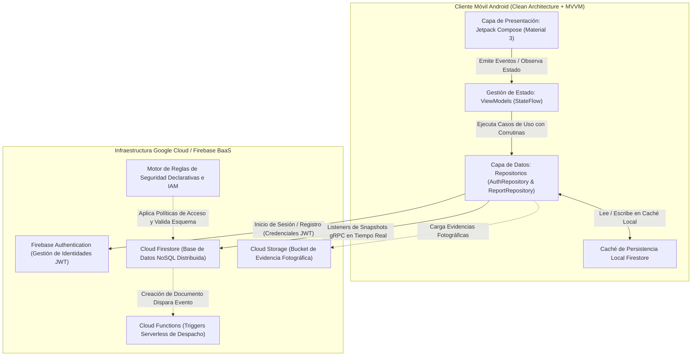

# EcoTrack: Telemetría Ambiental Ciudadana mediante Ingeniería Lean Mobile

<p align="center">
  
  
  
  
  
  
  
  
</p>

---

## Resumen Ejecutivo

**EcoTrack** es una solución móvil de alta fiabilidad concebida como **Producto Mínimo Viable (MVP)** bajo los principios de la **Metodología Lean Mobile**, orientada a la evaluación académica y la incubación en el semillero de investigación de la **Fundación Universitaria Católica del Norte (UCN)**. 

La plataforma resuelve la asimetría de información entre las comunidades urbanas y los sistemas municipales de saneamiento y gestión ambiental. Mediante la integración de ingeniería moderna en el cliente Android (**Kotlin 2.0**, **Jetpack Compose con Material Design 3**, arquitectura **MVVM** y flujo unidireccional de datos **UDF**) junto con una infraestructura serverless en la nube (**Google Firebase Authentication** y **Cloud Firestore**), EcoTrack faculta a los ciudadanos para geolocalizar, reportar y verificar incidentes de residuos clandestinos o puntos limpios de reciclaje con sincronización en milisegundos.

> 🌐 **Landing Page Web del Proyecto**: Se incluye una página interactiva moderna para la presentación del proyecto en [`landing/index.html`](landing/index.html).

---

## Tabla de Contenidos
1. [Propósito del Proyecto y Declaración del Problema](#1-propósito-del-proyecto-y-declaración-del-problema)
   - [Crisis en la Gestión Urbana de Residuos](#11-crisis-en-la-gestión-urbana-de-residuos)
   - [Metodología Lean Mobile y Justificación Técnica](#12-metodología-lean-mobile-y-justificación-técnica)
   - [Hipótesis Fundamentales: Construir - Medir - Aprender](#13-hipótesis-fundamentales-construir---medir---aprender)
2. [Características Principales del MVP](#2-características-principales-del-mvp)
3. [Arquitectura en la Nube y Justificación Técnica](#3-arquitectura-en-la-nube-y-justificación-técnica)
   - [¿Por qué Firebase Backend-as-a-Service (BaaS)?](#31-por-qué-firebase-backend-as-a-service-baas)
   - [Especificación de Componentes: Auth, Firestore y Extensiones](#32-especificación-de-componentes-auth-firestore-y-extensiones)
   - [Diagrama de Arquitectura de Sistemas (Mermaid.js)](#33-diagrama-de-arquitectura-de-sistemas-mermaidjs)
   - [Buenas Prácticas de Ingeniería de Software Aplicadas](#34-buenas-prácticas-de-ingeniería-de-software-aplicadas)
4. [Guía de Instalación y Despliegue en Android Studio](#4-guía-de-instalación-y-despliegue-en-android-studio)
   - [Requisitos Previos del Sistema](#41-requisitos-previos-del-sistema)
   - [Paso 1: Clonar e Inspeccionar el Repositorio](#42-paso-1-clonar-e-inspeccionar-el-repositorio)
   - [Paso 2: Configuración en Firebase Console](#43-paso-2-configuración-en-firebase-console)
   - [Paso 3: Vinculación de Credenciales (`google-services.json`)](#44-paso-3-vinculación-de-credenciales-google-servicesjson)
   - [Paso 4: Importación, Sincronización Gradle y Ejecución](#45-paso-4-importación-sincronización-gradle-y-ejecución)
   - [Diagnóstico y Resolución de Problemas (Troubleshooting)](#46-diagnóstico-y-resolución-de-problemas-troubleshooting)
5. [Potencial Académico e Innovación en Investigación (Semillero UCN)](#5-potencial-académico-e-innovación-en-investigación-semillero-ucn)
   - [Originalidad e Innovación Tecnológica](#51-originalidad-e-innovación-tecnológica)
   - [Líneas de Escalabilidad Algorítmica (Edge AI & GIS)](#52-líneas-de-escalabilidad-algorítmica-edge-ai--gis)
   - [Impacto Ambiental, Ciudadano y Social](#53-impacto-ambiental-ciudadano-y-social)
6. [Página de Presentación Web (Landing Page)](#6-página-de-presentación-web-landing-page)
7. [Evidencias de Ejecución y Capturas](#7-evidencias-de-ejecución-y-capturas)
8. [Autores y Reconocimientos Académicos](#8-autores-y-reconocimientos-académicos)

---

## 1. Propósito del Proyecto y Declaración del Problema

### 1.1 Crisis en la Gestión Urbana de Residuos
Las áreas metropolitanas y municipios en desarrollo experimentan graves ineficiencias causadas por la acumulación descontrolada de residuos y la falta de canalización oportuna. Los principales fallos en los canales tradicionales son:

1. **Asimetría de Información**: Los ciudadanos identifican puntos críticos de acumulación, contenedores colapsados o ausencia de puntos limpios en su cotidianidad; no obstante, las entidades de aseo municipal carecen de visibilidad espacial en tiempo real sobre estas dinámicas.
2. **Fricción Burocrática Extrema**: Los portales gubernamentales tradicionales de PQRSD están diseñados para computadores de escritorio, exigen formularios de más de 15 campos y carecen de geolocalización automática. Esta complejidad provoca un **abandono de usuarios superior al 65%** antes de formalizar la queja.
3. **Desconocimiento de Infraestructura de Reciclaje**: Los ciudadanos dispuestos a separar residuos en la fuente no disponen de un directorio comunitario validado con puntos específicos para residuos electrónicos, baterías de litio, material reciclable o compostaje orgánico.

### 1.2 Metodología Lean Mobile y Justificación Técnica
Para resolver esta problemática mitigando los sobrecostos de desarrollo y mantenimiento de software empresarial tradicional, EcoTrack adopta la **Metodología Lean Mobile** (adaptación de *The Lean Startup* de Eric Ries orientada a ecosistemas móviles nativos):

```
 ┌─────────────────────────────────────────────────────────────────┐
 │               Ciclo de Desarrollo Lean Mobile                   │
 │                                                                 │
 │      [1. HIPOTETIZAR] ──> Identificar Fricciones y Métricas     │
 │              │                                                  │
 │              ▼                                                  │
 │      [2. CONSTRUIR (MVP)] ──> Solo Funcionalidades Esenciales   │
 │              │               (Auth, Feed Reactivo, Reporte <30s)│
 │              ▼                                                  │
 │      [3. MEDIR]       ──> Telemetría Cloud y Velocidad          │
 │              │               (Tiempo de Reporte, Abandono)      │
 │              ▼                                                  │
 │      [4. APRENDER]    ──> Pivotar o Perseverar (Validar Demanda)│
 └─────────────────────────────────────────────────────────────────┘
```

Al concentrar el esfuerzo en el conjunto mínimo de funciones indispensables para validar la adopción ciudadana real, el enfoque Lean Mobile evita:
* **Sobreingeniería (Over-engineering)**: Desarrollar precipitadamente complejas tiendas de recompensas o pesados paneles web antes de comprobar si la comunidad realmente reporta incidencias.
* **Desperdicio de Capital e Infraestructura**: Evitar el aprovisionamiento de máquinas virtuales dedicadas, clústeres de bases de datos relacionales y balanceadores mediante el uso de infraestructura serverless elástica.

### 1.3 Hipótesis Fundamentales: Construir - Medir - Aprender

* **Hipótesis de Valor**: *"La ciudadanía participará activamente en el monitoreo y reporte de anomalías ambientales si el proceso móvil requiere menos de 3 interacciones y se completa en menos de 30 segundos."*
* **Hipótesis de Crecimiento y Fidelización**: *"Ofrecer un flujo transparente de estados en tiempo real (`Pendiente` $\rightarrow$ `En Revisión` $\rightarrow$ `Resuelto`) visible para toda la comunidad fomenta la validación colectiva y el hábito de reporte recurrente."*
* **Límites de Alcance del MVP**:
  * *Incluido en el MVP*: Autenticación basada en tokens criptográficos, feed reactivo en tiempo real, filtros horizontales por categoría ecológica, formulario ágil con georreferenciación y badges cromáticos de estado.
  * *Postpuesto para iteraciones futuras*: Modelos de visión por computador on-device, mapas térmicos GIS por capas, notificaciones push automáticas e integración directa con despachos municipales.

---

## 2. Características Principales del MVP

* ⚡ **Reportes Ultrarrápidos (< 30 segundos)**: Formulario optimizado sin fricción con categorización y geolocalización textual inmediata.
* 🔄 **Sincronización Cloud Sub-Segundo**: Propagación bidireccional instantánea de reportes a todos los usuarios conectados gracias a Kotlin Coroutines y Firestore Snapshot Listeners.
* 🗂️ **Filtros por Categorías Ecológicas**: Filtrado horizontal dinámico por:
  - *Puntos de Reciclaje*
  - *Vertederos Ilegales*
  - *Residuos Electrónicos (E-Waste)*
  - *Basura General*
  - *Compost Orgánico*
* 🟢 **Trazabilidad de Estados en Tiempo Real**: Visualización del ciclo de vida del reporte con codificación cromática:
  - `Pendiente` (Ámbar / Precaución)
  - `En Revisión` (Azul / Gestión en curso)
  - `Resuelto` (Verde / Saneado o Validado)
* 🔐 **Seguridad e Identidad Criptográfica**: Autenticación segura mediante Firebase Authentication (JWT RFC 7519), asociando la autoría de cada reporte a un UID inmutable.
* 📶 **Resiliencia Offline Nativa**: Capacidad de persistencia y cola de escritura local; los reportes registrados sin conexión se sincronizan automáticamente tan pronto el dispositivo recupera acceso a la red.

---

## 3. Arquitectura en la Nube y Justificación Técnica

### 3.1 ¿Por qué Firebase Backend-as-a-Service (BaaS)?
El desarrollo de un backend móvil tradicionalmente demanda aprovisionar pasarelas REST/GraphQL, bases de datos relacionales, microservicios OAuth, contenedores Docker y mantenimiento continuo de parches de seguridad. Para un despliegue Lean Mobile de alto impacto, **Google Firebase** representa la opción técnicamente óptima:

| Dimensión / Métrica | REST Tradicional (Spring / Node / Docker) | Google Firebase BaaS (Solución EcoTrack) |
| :--- | :--- | :--- |
| **Tiempo de Configuración** | Semanas (Aprovisionamiento, VPCs, BD) | Minutos (Integración vía SDK nativo) |
| **Transmisión en Tiempo Real** | Compleja (WebSockets manuales, Redis Pub/Sub) | Nativa (`callbackFlow` con listeners Firestore) |
| **Persistencia y Caché Offline** | Manual (Algoritmos de sincronización SQLite/Room) | Nativa (Caché y cola de escritura en el cliente) |
| **Mantenimiento Operativo** | Alto (Parcheo de SO, escalado de BD, CVEs) | Cero (Infraestructura serverless autogestionada) |
| **Escalabilidad Horizontal** | Manual con Kubernetes y balanceadores | Automática multi-región con sharding de documentos |
| **Seguridad de Autenticación** | Alta responsabilidad (Hashes, rotación de JWT) | Estándar Google Identity con IAM y reglas declarativas |

### 3.2 Especificación de Componentes: Auth, Firestore y Extensiones

1. **Firebase Authentication (Capa de Identidad)**:
   - Elimina vulnerabilidades locales al autenticar mediante JSON Web Tokens (JWT) firmados criptográficamente.
   - Gestiona silenciosamente la renovación de sesiones a través de Google Play Services.
   - Asegura que toda escritura en la base de datos esté permanentemente asociada a un UID legítimo (`request.auth.uid`).

2. **Cloud Firestore (Almacenamiento NoSQL Distribuido en Tiempo Real)**:
   - Estructura orientada a documentos optimizada para lectura concurrente y consultas filtradas por índices compuestos.
   - **Colección Principal**: `/eco_reports/{reportId}`
   - **Esquema de Documento**:
     ```typescript
     interface EcoReport {
       id: string;               // Identificador autogenerado por Firestore
       title: string;            // Título descriptivo (mínimo 3 caracteres)
       description: string;      // Contexto, urgencia y accesibilidad
       category: string;         // 'Puntos de Reciclaje' | 'Vertedero Ilegal' | 'Residuos Electrónicos' | ...
       location: string;         // Dirección o punto de referencia geolocalizado
       status: string;           // 'Pending' | 'In Review' | 'Resolved'
       userId: string;           // UID del usuario autenticado en Firebase Auth
       userEmail: string;        // Correo electrónico del ciudadano reportero
       timestamp: Timestamp;     // Marca temporal del servidor para orden cronológico
     }
     ```

3. **Cloud Storage y Cloud Functions (Ruta de Extensibilidad Post-MVP)**:
   - *Cloud Storage for Firebase*: Alojamiento de evidencia fotográfica comprimida en formato WebP.
   - *Firebase Cloud Functions*: Triggers en segundo plano para notificar automáticamente a cuadrillas municipales ante reportes de vertederos ilegales.

### 3.3 Diagrama de Arquitectura de Sistemas (Mermaid.js)



### 3.4 Buenas Prácticas de Ingeniería de Software Aplicadas

* **Arquitectura Limpia (Clean Architecture) y Separación de Responsabilidades**: Desacoplamiento total entre capas. La interfaz de usuario en Compose desconoce los SDKs de Firebase; toda interacción transita a través de contratos e interfaces en `AuthRepository` y `ReportRepository`.
* **Flujo Unidireccional de Datos (UDF)**: Los ViewModels exponen estados inmutables `StateFlow<UiState>`. Los componentes Composable emiten eventos hacia arriba (`onTitleChanged`, `submitReport`) y consumen estado hacia abajo, evitando condiciones de carrera.
* **Reglas de Seguridad Declarativas**: Las restricciones de integridad y negocio se ejecutan a nivel de nube mediante `firestore.rules`, impidiendo modificaciones no autorizadas o corrupción de esquemas.
* **Gestión Moderna de Dependencias**: Utilización del Catálogo de Versiones de Gradle (`gradle/libs.versions.toml`) y el **Firebase BoM (Bill of Materials)** para garantizar total compatibilidad entre librerías.

---

## 4. Guía de Instalación y Despliegue en Android Studio

Sigue este procedimiento paso a paso para clonar, configurar, compilar y ejecutar EcoTrack en tu entorno local.

### 4.1 Requisitos Previos del Sistema
* **Android Studio**: Versión Koala (2024.1.1+), Jellyfish o Hedgehog con Android SDK Platform 34 instalado.
* **Java Development Kit**: JDK 17 (incluido de forma nativa en Android Studio).
* **Dispositivo Físico o Virtual**: Dispositivo Android o Emulador AVD con **Android 7.0 (API Nivel 24) o superior** y los **Servicios de Google Play (Google Play Services)** activados.
* **Cuenta de Google**: Acceso a la [Consola de Firebase](https://console.firebase.google.com/).

### 4.2 Paso 1: Clonar e Inspeccionar el Repositorio
Clona el repositorio utilizando Git o descarga el código fuente:
```bash
git clone https://github.com/your-username/ecotrack-app.git
cd ecotrack-app
```

Estructura del proyecto:
```
ecotrack-app/
├── gradle/libs.versions.toml          # Catálogo de versiones centralizado
├── app/
│   ├── build.gradle.kts              # Script de compilación del módulo
│   ├── google-services.json          # Credenciales del proyecto en Firebase
│   └── src/main/
│       ├── AndroidManifest.xml       # Declaración de manifiesto y permisos
│       ├── java/com/ecotrack/app/    # Código fuente Kotlin (UI, ViewModel, Data)
│       └── res/values/strings.xml    # Cadenas y localización de la interfaz
├── docs/                             # Documentación técnica y académica
│   ├── ARCHITECTURE.md               # Detalle arquitectónico y reglas de seguridad
│   └── PRESENTATION_SLIDES.md        # Diapositivas para sustentación académica
├── landing/                          # Landing page web interactiva
│   ├── index.html                    # Estructura semántica moderna
│   ├── styles.css                    # Sistema de diseño bespoke (Vanilla CSS)
│   └── script.js                     # Simulador interactivo y calculadora de impacto
├── build.gradle.kts                  # Script de compilación raíz
├── settings.gradle.kts               # Configuración de repositorios y módulos
└── README.md                         # Documentación principal en español
```

### 4.3 Paso 2: Configuración en Firebase Console
1. Ingresa a la [Consola de Firebase](https://console.firebase.google.com/) e inicia sesión con tu cuenta de Google.
2. Haz clic en **Agregar proyecto** (o *Add project*) y nómbralo `ecotrack-mvp`.
3. En la pantalla principal del proyecto, haz clic en el ícono de **Android (robot)** para registrar una aplicación Android:
   * **Nombre de paquete de Android**: `com.ecotrack.app` *(Debe coincidir con el `applicationId` en `app/build.gradle.kts`)*.
   * **Apodo de la aplicación**: `EcoTrack App`.
   * **Certificado de firma de depuración SHA-1**: *(Opcional para correo/contraseña; requerido si se activa Google Sign-In)*.
4. Haz clic en **Registrar app**.

### 4.4 Paso 3: Vinculación de Credenciales (`google-services.json`)
1. Descarga el archivo generado `google-services.json` provisto por el asistente de Firebase.
2. Copia o mueve el archivo dentro del directorio `app/` de tu proyecto local:
   ```
   ecotrack-app/app/google-services.json
   ```
3. Activa los servicios indispensables en la Consola de Firebase:
   * **Firebase Authentication**: Navega a *Compilación $\rightarrow$ Authentication $\rightarrow$ Comenzar $\rightarrow$ Método de acceso*. Habilita el proveedor **Correo electrónico/contraseña** y guarda los cambios.
   * **Cloud Firestore**: Navega a *Compilación $\rightarrow$ Firestore Database $\rightarrow$ Crear base de datos*. Selecciona una región cercana y opta por **Comenzar en modo de prueba** para desarrollo inicial (o aplica las reglas declarativas de producción ubicadas en [`docs/ARCHITECTURE.md`](docs/ARCHITECTURE.md)).

### 4.5 Paso 4: Importación, Sincronización Gradle y Ejecución
1. Abre **Android Studio**.
2. Selecciona **File $\rightarrow$ Open** y escoge el directorio raíz `ecotrack-app`.
3. Android Studio ejecutará automáticamente la sincronización de Gradle (*Gradle Sync*). Espera a que finalice la indexación.
4. Conecta tu dispositivo físico mediante Depuración USB o inicia un emulador de Android (AVD con soporte para Google Play).
5. Haz clic en el botón verde **Run 'app'** (o presiona `Shift + F10`).
6. La aplicación se instalará e iniciará en la pantalla de bienvenida y autenticación.

### 4.6 Diagnóstico y Resolución de Problemas (Troubleshooting)
* **Error: `File google-services.json is missing`**: Verifica que el archivo `google-services.json` esté ubicado estrictamente dentro de la carpeta `app/` y no en la raíz del repositorio.
* **Error: `Default FirebaseApp is not initialized`**: Confirma que la clase de aplicación `EcoTrackApp` esté declarada en `AndroidManifest.xml` mediante el atributo `android:name=".EcoTrackApp"`.
* **Error de permisos o red en Cloud Firestore**: Asegúrate de que el emulador o dispositivo físico cuente con conexión activa a internet y que las reglas de seguridad de Firestore permitan lectura y escritura para usuarios autenticados (`request.auth != null`).

---

## 5. Potencial Académico e Innovación en Investigación (Semillero UCN)

EcoTrack está estructurado para servir como base de investigación aplicada en el **Semillero de Investigación en Ingeniería de Software y Computación Móvil** de la **Fundación Universitaria Católica del Norte (UCN)**.

### 5.1 Originalidad e Innovación Tecnológica
* **Telemetría Ambiental Ciudadana (Citizen Sensing)**: Convierte los teléfonos inteligentes cotidianos en nodos de monitoreo ecológico sin requerir sensores de hardware adicionales.
* **Sincronización Comunitaria Sub-Segundo**: Elimina los rezagos de respuesta estatal publicando puntos ecológicos de manera reactiva mediante flujos en la nube.
* **Ergonomía Móvil de Mínima Fricción**: Demuestra cómo la optimización de UX previene directamente el abandono de iniciativas ciudadanas.

### 5.2 Líneas de Escalabilidad Algorítmica (Edge AI & GIS)
Gracias a la Clean Architecture implementada, futuros investigadores pueden integrar los siguientes módulos sin refactorizar la lógica central:

1. **Visión por Computador en el Dispositivo (Edge AI con TensorFlow Lite / Google ML Kit)**:
   - Integración de una red neuronal convolucional (CNN) optimizada para inferencia on-device que identifique plásticos PET, aluminio, cartón o residuos peligrosos en el visor de la cámara antes de enviar el reporte.
2. **Inteligencia Geoespacial y Mapas de Calor (Clustering GIS)**:
   - Visualización sobre Google Maps SDK aplicando algoritmos de agrupamiento espacial basados en densidad (**DBSCAN**) para detectar focos emergentes de vertederos clandestinos y predecir vectores de dispersión.
3. **Interoperabilidad Abierta para Ciudades Inteligentes (Smart City Dispatch)**:
   - Construcción de un puente automatizado entre Cloud Firestore y los sistemas ERP o mesas de ayuda municipal mediante Firebase Cloud Functions para canalizar órdenes de servicio inmediatas.

### 5.3 Impacto Ambiental, Ciudadano y Social
* **Salud Pública**: La detección temprana de vertederos clandestinos mitiga lixiviados tóxicos, plagas y proliferación de vectores de enfermedades (dengue, zika).
* **Economía Circular Acelerada**: Orienta a los vecinos hacia los puntos adecuados de reciclaje y gestión de residuos electrónicos, evitando que terminen en rellenos sanitarios ordinarios.
* **Transparencia Ciudadana y Gobernanza Participativa**: La trazabilidad pública de estados compromete a las entidades responsables y a las juntas de acción comunal con el saneamiento efectivo del entorno.

---

## 6. Página de Presentación Web (Landing Page)

El proyecto incluye una **landing page web completa, interactiva y de estética visual premium** ubicada en la carpeta [`landing/`](landing/):

```
landing/
├── index.html     # Estructura semántica, metaetiquetas SEO y OpenGraph
├── styles.css     # Estilos Vanilla CSS con diseño glassmorphism, paleta eco y microanimaciones
└── script.js      # Simulador interactivo de app móvil y calculadora de impacto ecológico
```

### Características de la Landing Page:
* **Simulador Interactivo de EcoTrack en Vivo**: Marco interactivo de smartphone que permite alternar pestañas (Panel, Reportar, Iniciar Sesión), probar filtros dinámicos por categorías, cambiar el estado de los reportes en tiempo real y enviar un eco-reporte de prueba con confirmación visual.
* **Calculadora de Impacto Ecológico Comunitario**: Deslizador interactivo para estimar la reducción de CO₂, kilogramos de residuos reciclados y tiempo de atención vecinal.
* **Visualizador Interactivo de Arquitectura**: Explorador interactivo de los componentes clave (Android Compose, Firebase Auth, Cloud Firestore y Caché Offline).
* **Diseño Responsivo y Temas**: Adaptado con total fluidez a dispositivos móviles, tablets y monitores de alta resolución con selector de modo claro/oscuro.

Para abrirla localmente, basta con abrir el archivo [`landing/index.html`](landing/index.html) en cualquier navegador web moderno.

---

## 7. Evidencias de Ejecución y Capturas

A continuación se disponen los marcadores de posición estandarizados para adjuntar las evidencias visuales del proyecto y sustentar su evaluación académica:

### 7.1 Evidencias de la Aplicación Móvil en Ejecución

| Autenticación de Ciudadanos | Panel Principal y Filtros Temáticos | Formulario de Creación de Reportes |
| :---: | :---: | :---: |
| <br>*(Fig 1.1: Inicio de sesión y registro con validación)* | <br>*(Fig 1.2: Feed en tiempo real y chips de estado)* | <br>*(Fig 1.3: Registro rápido y geolocalización)* |

| Filtrado Activo de Incidentes | Actualizaciones Dinámicas de Estado | Persistencia y Modo Offline |
| :---: | :---: | :---: |
| <br>*(Fig 1.4: Filtros dinámicos por categorías)* | <br>*(Fig 1.5: Transición a estado 'Resuelto')* | <br>*(Fig 1.6: Escritura y lectura en caché local sin red)* |

### 7.2 Evidencias del Backend en Google Firebase

| Consola de Firebase Authentication | Árbol de Documentos en Cloud Firestore | Verificación de Reglas de Seguridad |
| :---: | :---: | :---: |
| <br>*(Fig 2.1: Cuentas de ciudadanos y UIDs registrados)* | <br>*(Fig 2.2: Colección en vivo `eco_reports`)* | <br>*(Fig 2.3: Reglas de seguridad activas en la nube)* |

---

## 8. Autores y Reconocimientos Académicos

* **Institución**: Fundación Universitaria Católica del Norte (UCN)
* **Programa Académico**: Ingeniería de Software / Informática
* **Asignatura**: Diseño de Aplicaciones Móviles (Semestre 4)
* **Marco Metodológico**: Lean Mobile Software Development (Eric Ries / Patrones UDF Android)
* **Rol del Desarrollador**: Ingeniero de Software / Arquitecto de Soluciones Móviles

---
*EcoTrack — Empoderando a las comunidades para monitorear, reportar y preservar la ecología urbana.*
