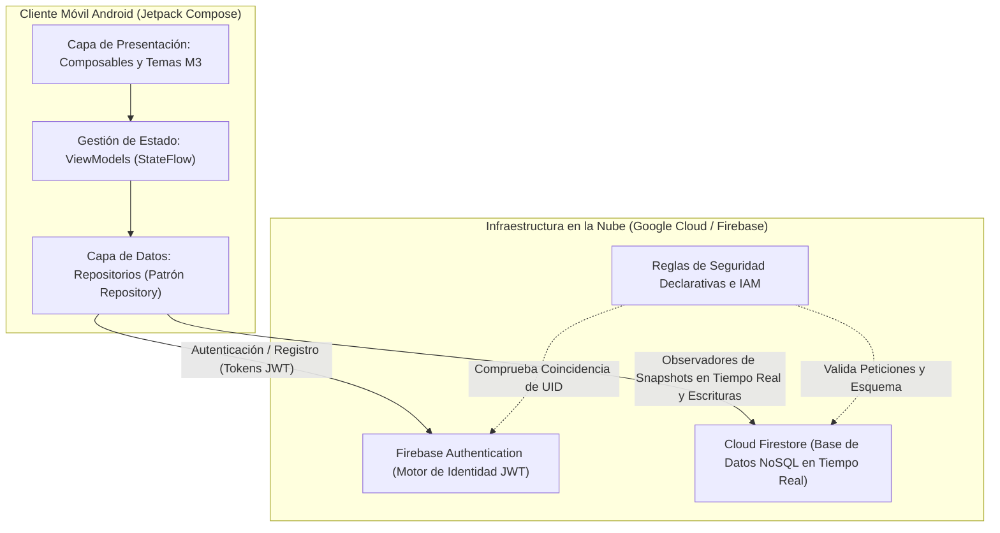
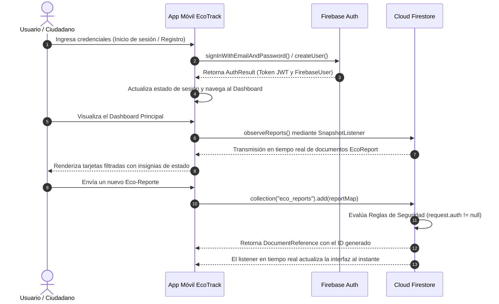

# EcoTrack: Arquitectura de Sistemas Móviles y en la Nube

## 1. Descripción General del Sistema y Arquitectura Lean Mobile

EcoTrack ha sido diseñado bajo los principios de la **Metodología Lean Mobile**, con el objetivo de maximizar el impacto en la comunidad ciudadana minimizando el desperdicio operacional y los costos de infraestructura. El sistema implementa **Firebase Backend-as-a-Service (BaaS)** para prescindir del despliegue y mantenimiento de microservicios tradicionales dedicados, asegurando consistencia de datos en tiempo real, escalabilidad sin servidor (serverless) y una alta reactividad en dispositivos móviles.



---

## 2. Componentes de Firebase en la Nube

### 2.1 Firebase Authentication (Motor de Gestión de Identidades)
- **Motor**: Firebase Auth SDK para Android.
- **Proveedor**: Autenticación mediante Correo Electrónico y Contraseña con validación estándar RFC 5322.
- **Ciclo de Vida de Sesión**: Administrado automáticamente mediante JSON Web Tokens (JWT) firmados criptográficamente, renovados en segundo plano a través de Google Play Services.
- **Rol en el Negocio**: Desacopla la gestión de credenciales sensibles de la lógica de negocio, garantizando que todo reporte ambiental cuente con la trazabilidad de un usuario autenticado.

### 2.2 Cloud Firestore (Base de Datos NoSQL Distribuida)
- **Modelo de Datos**: Almacenamiento NoSQL orientado a documentos estructurado para alta concurrencia de lectura y reportes comunitarios descentralizados.
- **Colección Principal**: `/eco_reports/{reportId}`
- **Esquema de Datos de la Colección**:

| Campo | Tipo de Dato | Descripción | Indexación |
| :--- | :--- | :--- | :--- |
| `id` | String (Auto-ID) | Identificador único del documento en Firestore | Clave Primaria |
| `title` | String | Título descriptivo del incidente o punto ecológico | Estándar |
| `description` | String | Detalles sobre el estado, accesibilidad y gravedad | Ninguna |
| `category` | String | Categoría: `Recycling Station`, `Illegal Dumping`, `Electronic Waste`, `General Waste`, `Organic Compost` | Compuesta Ascendente |
| `location` | String | Dirección textual o coordenadas georreferenciadas | Estándar |
| `status` | String | Estado del flujo: `Pending` (Pendiente), `In Review` (En Revisión), `Resolved` (Resuelto) | Compuesta Ascendente |
| `userId` | String | UID de Firebase Authentication del ciudadano autor | Compuesta Ascendente |
| `userEmail` | String | Correo electrónico de contacto del autor | Estándar |
| `timestamp` | Timestamp | Marca temporal en UTC asignada por el servidor o cliente | Descendente (Orden predeterminado) |

---

## 3. Flujo de Datos y Red Extremo a Extremo



---

## 4. Reglas de Seguridad Declarativas de Cloud Firestore

Para garantizar la integridad de los datos y evitar mutaciones no autorizadas, se configuran las siguientes reglas declarativas para el despliegue en `firestore.rules`:

```javascript
rules_version = '2';
service cloud.firestore {
  match /databases/{database}/documents {
    
    // Reglas para la colección de eco-reportes
    match /eco_reports/{reportId} {
      // Cualquier usuario autenticado puede consultar los reportes públicos
      allow read: if request.auth != null;
      
      // Solo usuarios autenticados pueden crear reportes vinculando su propio UID
      allow create: if request.auth != null 
                    && request.resource.data.userId == request.auth.uid
                    && request.resource.data.title.size() >= 3
                    && request.resource.data.status == "Pending";
      
      // Permitir actualización de estado a usuarios autenticados
      allow update: if request.auth != null;
      
      // Eliminación restringida estrictamente al autor original del reporte
      allow delete: if request.auth != null 
                    && resource.data.userId == request.auth.uid;
    }
  }
}
```

---

## 5. Atributos de Calidad Arquitectónica y Métricas Lean
1. **Cero Latencia de Inicio en Frío (Offline Persistence)**: La caché local integrada de Firestore en Android encola escrituras locales y despliega datos de inmediato incluso ante conectividad intermitente.
2. **Escalabilidad Horizontal Automática**: La infraestructura multi-región de Google Cloud Firestore particiona colecciones automáticamente sin requerir gestión manual de servidores.
3. **Bajo Consumo de Batería y Datos**: El listener basado en eventos utiliza multiplexación gRPC/WebSockets, eliminando sondeos periódicos (polling HTTP) costosos para la batería del dispositivo móvil.
